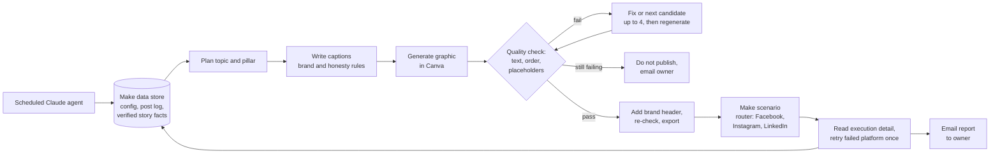

# Lynn Resumes: AI social media automation

An AI-agent marketing system I designed and run for **Lynn Resumes**, my CV writing and career coaching business in Kenya. Scheduled Claude agents plan the content, write the captions, create and quality-check the graphics in Canva, publish through Make, log every run and email me a report. The WhatsApp Status pack is the one part I post myself, because WhatsApp has no Status API.

Built with Claude as the agent layer, Make for the social media integrations, and Canva for design. In production since November 2026.

## What it does
| Agent | Schedule (Nairobi) | Output |
|---|---|---|
| [Social post agent](prompts/social-post-agent.md) | Mon, Wed, Fri, 7:15 PM | Educational tip, client story or offer post, published to the Facebook page and Instagram |
| [Weekly reel agent](prompts/weekly-reel-agent.md) | Tuesday, 7:15 PM | 4-slide vertical text reel, published to Facebook and Instagram; TikTok version prepared for manual posting |
| [WhatsApp Status agent](prompts/whatsapp-status-agent.md) | Daily, 6:17 AM | Email with three checked Status graphics and captions for the day |
| Monthly review agent | 1st of the month | Reads the business's lessons logs and emails proposed new rules for approval (never changes a rule itself) |

## How it works



1. **State in one place.** Agents start each run with no memory, so a Make data store holds the business facts they may use (`config`), a record for every post, and verified facts for each client screenshot. See [docs/data-store.md](docs/data-store.md).
2. **One Make scenario per format.** [Publish Post](make/publish-post.blueprint.json) and [Publish Reel](make/publish-reel.blueprint.json) are on-demand scenarios with a router: the agent passes a `platforms` list, and filters send the post only to the platforms requested. Each module has its own error handler, so one platform failing does not block the others.
3. **The agent checks its own work before publishing.** Canva's AI often adds template placeholder text or jumbles numbered steps, so every graphic is read back (text and thumbnail) and rejected or fixed before it goes out. If nothing passes, it does not publish.
4. **Idempotent runs.** The agent checks the log before posting, and on a gateway timeout it looks up the run it already started rather than running the scenario again, so posts are never doubled.
5. **A human stays in the loop.** Every run emails a plain report with the design link, captions and any fix needed.

## Guardrails written into the agents
- Only facts in the data store may be used: official prices, proof points exactly as written, and client details only from the verified screenshot facts.
- Never invent testimonials, results, statistics, discounts or deadlines; never promise jobs or interviews.
- Never post more than once per platform per day, and never edit or delete existing posts.
- When anything is ambiguous, do not post; explain in the email instead.

## Problems found in production and how they were fixed
| Problem | Fix |
|---|---|
| Canva AI added placeholder text ("123 Anywhere St.") and jumbled step numbers | Mandatory read-back quality check; fix with edit-design or try other candidates; never publish a failing design |
| Brand header was unreliable when requested in the AI prompt | Header added deterministically with edit-design after generation, then re-checked |
| Canva generate-design started failing on most runs (Nov 2026) | Fallback: copy a previously checked layout and rewrite its text |
| Posts meant for the LinkedIn company page appeared on my personal profile (both modules share one connection, and errors are set to Ignore) | LinkedIn publishing switched off; captions emailed for manual posting until the connection is re-authorised with page permissions and tested |
| Make's free plan hides per-module results | The report flags "sent but unconfirmed" and asks me to check the page, rather than claiming success |
| A rejected design's link was emailed by mistake | Rule added: email only the edit link of the design that passed and was committed |

## Repository contents
```
make/      Sanitised Make scenario blueprints (connection, page and account IDs replaced with placeholders)
prompts/   Condensed versions of the scheduled agent prompts
docs/      Data store design
```

## Tech
Claude (scheduled agents, tool use through MCP connectors) · Make (scenarios, router and filters, data store, Facebook Pages, Instagram Business and LinkedIn modules) · Canva (through its MCP connector: generation, editing, read-back and export) · Gmail

## Author
Carol Njogu, PMP · [LinkedIn](https://www.linkedin.com/in/carol-njogu)
